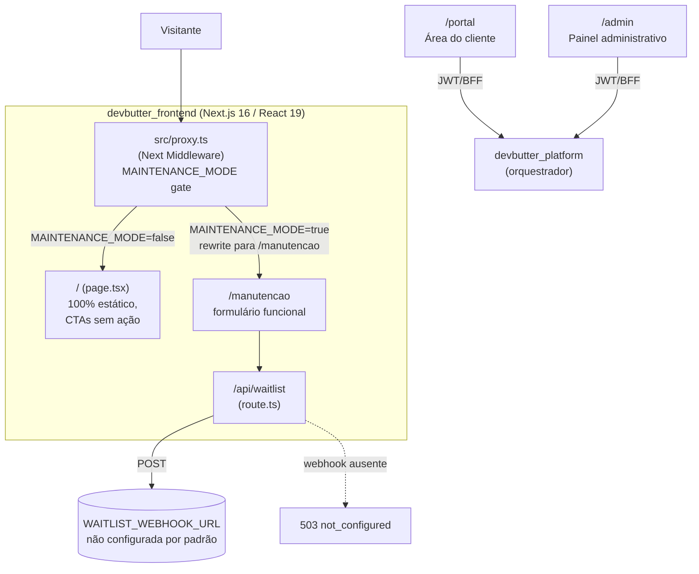

# devbutter_frontend

Site institucional da DevButter e frontend do portal/admin em Next.js. A home continua sem CMS
próprio, mas portal e admin usam autenticação JWT e dados do `devbutter_backend`. É o único dos 5
serviços do ecossistema escrito em TypeScript/React; os outros quatro (`asaas_payment`,
`butter_mind`, `butter_relay`, `devbutter_platform`) são FastAPI.

> Este README substitui o boilerplate padrão do `create-next-app`. Para o levantamento completo do
> que falta implementar (CTAs, rotas, CMS, SEO), ver
> [`docs/funcoes-necessarias-site.md`](../docs/funcoes-necessarias-site.md) — este documento cobre
> a estrutura e o estado atual do código, não repete aquele levantamento.

## Estado atual (resumo)

- Home 100% estática: projetos, copy do concierge e da simulação de chat estão hardcoded nos
  componentes — não há CMS nem fonte de dados.
- A página `/manutencao` usa `POST /api/waitlist` e depende de uma env var não configurada por
  padrão.
- Portal e admin fazem chamadas server-side autenticadas ao `devbutter_backend`; o chat do portal
  usa handlers BFF em `/api/portal/conversations`.
- Todo CTA da home ("Solicitar diagnóstico", "Falar com a IA", "Ver cases", links de projeto) é
  puramente visual — sem rota ou handler por trás.

## Arquitetura



`src/proxy.ts` é o Next Middleware (o nome do arquivo é literal — `proxy`, não `middleware`, mas a
função exportada e o `matcher` seguem a API padrão do Next). Com `MAINTENANCE_MODE=true`, toda rota
é reescrita para `/manutencao` preservando a URL visível, exceto `api/`, assets estáticos e a
própria rota de manutenção — decidido em build time via env var, então mudar o valor exige novo
deploy.

## Estrutura de componentes (home)

```
src/app/
├── layout.tsx            # fontes Geist/Geist Mono, <html lang="pt-BR">, metadata (title/description)
├── page.tsx               # monta a home: Nav, Hero, FeatureStrip, Projects, Concierge,
│                          # DataDecision, ChatSimulation, ClosingCta, Footer
├── manutencao/page.tsx     # página de waitlist (único fluxo ponta a ponta)
└── api/waitlist/route.ts    # POST — valida e-mail, encaminha para WAITLIST_WEBHOOK_URL

src/components/
├── Nav/                  # header sticky, CTAs "Falar com a IA" / "Solicitar diagnóstico" (sem ação)
├── Hero/                 # headline + ilustração (node-map/flask SVG, ver Flask3D)
├── Flask3D/              # cena 3D (react-three-fiber + three.js) do frasco da marca
├── FeatureStrip/         # 4 cards de feature (estático)
├── Projects/             # cases em destaque — hardcoded (Crate Diggr, Orbit AI, GranAI, PlantOS, Spotme)
├── Concierge/             # simulação do "concierge de IA" (terminal), texto fixo
├── DataDecision/          # seção de animação scroll-scrubbed ("Da informação à decisão")
│   ├── storyboard.ts        # dados da timeline da animação
│   ├── StoryboardStage.tsx    # renderização da cena
│   └── StoryboardCompact.tsx   # variante compacta
├── ChatSimulation/        # simulação de chat "na prática" — mensagens hardcoded, sem input real
├── ClosingCta/            # CTA final "Solicitar diagnóstico"
├── Footer/                # sem links reais (redes sociais, e-mail, endereço)
├── Maintenance/           # página /manutencao: formulário, status log, copy por variante
├── StreamingText/          # efeito de texto "digitando" reutilizado em Concierge/ChatSimulation
└── icons/                 # Logomark (frasco + `</>`) e outros ícones inline SVG

src/hooks/
├── useMediaQuery.ts
├── usePrefersReducedMotion.ts   # respeita prefers-reduced-motion (ver design_handoff_homepage/README.md)
└── useRevealOnce.ts             # IntersectionObserver, dispara reveal uma única vez

src/styles/
├── _tokens.scss       # cores, espaçamento (paleta DevButter: verde #79E59B, rosa #F64C6F)
└── _animations.scss   # keyframes reutilizados (fadeUp, floaty, gridmove etc.)
```

Este componente-a-componente corresponde ao design em
[`design_handoff_homepage/README.md`](../design_handoff_homepage/README.md) (o handoff de design
hi-fi) — a implementação em código segue a mesma seção-a-seção descrita lá.

## `/api/waitlist`

Valida o formato do e-mail com regex, e só então encaminha `{ email, source: "manutencao" }` via
`POST` para `WAITLIST_WEBHOOK_URL`. Sem essa env var configurada, responde `503 not_configured` —
esse é o estado padrão hoje (`.env.example` a deixa vazia). Não há deduplicação de e-mail nem
confirmação por e-mail ao inscrito — só confirmação visual na tela.

## Tech stack

| Camada | Escolha |
|---|---|
| Framework | Next.js 16 (App Router) + React 19 |
| 3D/animação | `@react-three/fiber` 9 + `three` 0.185 (usado só em `Flask3D`) |
| Estilo | Sass Modules (`.module.scss`) + tokens em `_tokens.scss` — sem Tailwind/CSS-in-JS |
| Fontes | Geist / Geist Mono via `next/font/google` |
| Lint | ESLint 9 (`eslint-config-next`) |
| Package manager | Yarn 1 (`packageManager` fixado no `package.json`) |

Nenhuma dependência de banco de dados, autenticação, CMS, analytics ou testes automatizados está
presente no `package.json` — o projeto hoje não tem suíte de testes.

## Variáveis de ambiente

| Variável | Default | Notas |
|---|---|---|
| `MAINTENANCE_MODE` | `false` | Reescreve toda rota para `/manutencao` quando `true` |
| `MAINTENANCE_VARIANT` | `reconstrucao` | Ou `construcao` — lida em build time, muda a copy da página de manutenção |
| `WAITLIST_WEBHOOK_URL` | — (vazio) | Sem ela, `/api/waitlist` sempre responde 503 |
| `API_BASE_URL` | `http://localhost:8000` | Origem server-only da API consumida pelo portal e painel administrativo |

## Rodando localmente

```bash
yarn install
yarn dev
```

Abra `http://localhost:3000`. `AGENTS.md`/`CLAUDE.md` documentam que esta é uma versão do Next.js
com breaking changes relevantes para agentes de IA gerando código aqui — ver
`node_modules/next/dist/docs/` antes de assumir comportamento de versões anteriores.

## Lacunas conhecidas

Ver o levantamento completo em
[`docs/funcoes-necessarias-site.md`](../docs/funcoes-necessarias-site.md). Resumo das mais
relevantes do ponto de vista de arquitetura de código:

- Nenhuma rota existe para os itens do menu (`Soluções`, `Cases`, `Sobre`, `Insights`) — todos são
  `href="#"`.
- Nenhuma fonte de dados (CMS/MDX/JSON/banco) para os cases em `Projects.tsx` — editar um projeto
  em destaque hoje exige alterar código e novo deploy.
- A home ainda não integra `devbutter_platform`: CTAs de diagnóstico e chat continuam decorativos;
  o concierge funcional está no portal autenticado.
- Sem `sitemap.xml`, `robots.txt`, OG image, analytics ou dados estruturados (schema.org) — só
  `title`/`description` em `layout.tsx`.
- Sem política de privacidade/termos — necessário antes de captar e-mail/lead sob a LGPD.
